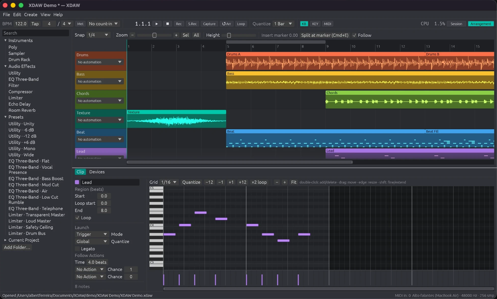

# XDAW



XDAW is an independent desktop DAW written in Rust: a clip-launching Session grid, a linear
Arrangement timeline, MIDI and audio recording, its own instruments and effects, mixing and
export. Its name, code, file format, sounds, presets and look are its own. It contains no
proprietary code, libraries or assets, is not affiliated with any DAW vendor, and makes no claim
of sound equivalence to any commercial product (see [NOTICE](NOTICE)).

Development follows a documented clean-room policy: the implementation is written against XDAW's
own functional specifications, and the provenance of every outside source is recorded. See
[docs/CLEAN_ROOM.md](docs/CLEAN_ROOM.md).

Status: early milestone on **macOS Apple Silicon** (only platform built and tested). The core is
portable; Windows and Linux are **not verified**. See [docs/FEATURE_MATRIX.md](docs/FEATURE_MATRIX.md)
for exactly what is implemented and verified.

## Build

Requirements: Rust 1.85+ (tested with 1.99.0) and Xcode Command Line Tools.

```bash
cargo build --release --locked
```

Run the tests (offline, no audio device needed):

```bash
cargo test --workspace --locked
```

Generate the demo session (all samples are synthesized by XDAW itself):

```bash
cargo run --release -p xdaw-engine --bin xdaw-make-demo -- "demo/XDAW Demo"
```

Start the app with the demo:

```bash
cargo run --release -p xdaw-ui --bin xdaw -- "demo/XDAW Demo/XDAW Demo.xdaw"
```

Package `dist/XDAW.app` and a zip:

```bash
./scripts/package-macos.sh
```

## Headless tools

- `xdaw-headless play <set.xdaw> [seconds] [buffer]` — plays through the default device, launching
  each scene, and prints callback timing (mean/percentiles/max vs. budget), deadline misses,
  CPU and peak memory.
- `xdaw-headless export <set.xdaw> <out.wav> [16|24|32]` — renders the Arrangement offline.
- `XDAW_SCRIPT="wait 2; scene 2; wait 4; shot /tmp/a.png; quit" xdaw <set.xdaw>` — scripted UI
  driver used for end-to-end checks (see `crates/ui/src/script.rs`).

## Documentation

- [User guide](docs/USER_GUIDE.md)
- [Architecture](docs/ARCHITECTURE.md)
- [Project file format](docs/PROJECT_FORMAT.md)
- [Feature matrix and verification status](docs/FEATURE_MATRIX.md)
- [Dependencies and licenses](docs/DEPENDENCIES.md)
- [Functional specifications](docs/specs/)
- [Clean-room policy and provenance](docs/CLEAN_ROOM.md)
- [Research notes (provenance record)](docs/research/)
- [Progress log and next steps](docs/PROGRESS.md)

## License

MIT OR Apache-2.0 ([LICENSE-MIT](LICENSE-MIT), [LICENSE-APACHE](LICENSE-APACHE)). Contributions follow
[CONTRIBUTING.md](CONTRIBUTING.md).
